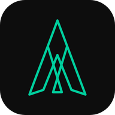

<p align="center"></p>

# Rúbrica

Editor PDF **libre y gratuito** para Windows: leer, comentar, editar, organizar, rellenar, **firmar digitalmente**, proteger y convertir documentos PDF, con apertura y guardado en **este equipo, OneDrive o Google Drive**. Sin suscripciones ni nube propia.

Creado por **ZMA Inversiones** (San Pedro Sula, Honduras) como alternativa abierta a Wondershare PDFelement y Adobe Acrobat. Código bajo licencia MIT: puede usarlo, revisarlo, modificarlo y redistribuirlo.

## Descargar

Vaya a **[Releases](../../releases)** y descargue:

- Windows (Intel/AMD): `Rubrica-Setup-x.y.z.exe`
- Windows en ARM (por ejemplo, portátiles con Snapdragon): `Rubrica-Setup-x.y.z-arm64.exe`
- Android: `Rubrica-Android-x.y.z.apk` (ver [docs/android.md](docs/android.md))

El instalador no requiere permisos de administrador, instala WebView2 si falta y está en español, inglés y portugués. La aplicación avisa cuando hay una versión nueva y se actualiza sola, solo si la firma de la actualización es válida. El OCR funciona sin internet.

> Windows puede mostrar «Windows protegió su PC» porque el instalador no está firmado con un certificado de editor. Pulse *Más información → Ejecutar de todas formas*.

## Funciones

| Área | Funciones |
|---|---|
| **Inicio** | Abrir (equipo, OneDrive, Google Drive, arrastrar y soltar, «Abrir con» de Windows), pestañas, recientes, guardar / guardar como, imprimir, combinar, **armar expediente** (portada con datos, índice con enlaces, marcadores, Bates y tamaño máximo; plantillas para aduanas y licitaciones), PDF desde imágenes, documento en blanco, deshacer/rehacer |
| **Comentar** | Resaltar, subrayar y tachar ajustados al texto; notas (comentarios PDF reales); cuadros de texto; sellos (APROBADO, RECIBIDO CONFORME, LIQUIDADO, AFORADO, COPIA FIEL… o propios, con fecha, hora y nombre); lápiz, rectángulo, elipse, línea, flecha; borrador |
| **Editar** | Editar el texto existente (detecta la fuente original), agregar texto e imágenes, códigos QR y de barras (Code 128), corrector, marca de agua, fondo, encabezado y pie, números de página, numeración Bates, recortar |
| **Fuentes** | **Aptos** como fuente predeterminada (igual que Microsoft Office), cualquier fuente instalada o de Microsoft 365, fuentes propias (.ttf/.otf); todas se incrustan en el PDF |
| **Organizar** | Miniaturas con arrastrar para reordenar, girar, insertar, duplicar, eliminar, extraer, dividir, invertir |
| **Convertir** | A Word, Excel, imágenes y texto; **desde Word, Excel y PowerPoint** (app de Windows, con Office o LibreOffice); OCR sin internet (español, inglés, portugués, francés); comprimir; **ajustar al tamaño de un portal** (comprimir o dividir en partes de máximo X MB) |
| **Formulario** | Rellenar formularios, crear campos (texto, casilla, lista), exportar datos a CSV |
| **Android** | Escáner de documentos con la cámara (bordes, perspectiva, filtros, OCR sin conexión), abrir/guardar en el teléfono, Drive y OneDrive, «Abrir con», compartir, imprimir, interfaz táctil para teléfono y Fold |
| **Proteger** | **Firma digital** con certificado `.p12/.pfx` (p. ej. el emitido por el SAR) o del almacén de Windows / token USB; verificación de firmas; firma manuscrita; contraseña AES‑256 y permisos; redacción permanente |

Detalles: [docs/firma-digital.md](docs/firma-digital.md) · [docs/configurar-nube.md](docs/configurar-nube.md) · [docs/arquitectura.md](docs/arquitectura.md)

## Firma digital

- Firma CMS/PKCS#7 desacoplada con SHA‑256 (`adbe.pkcs7.detached`), validada por Adobe Acrobat/Reader, Poppler y pyHanko.
- Se agrega como actualización incremental: firmar de nuevo o agregar comentarios **no invalida** las firmas anteriores.
- El panel **Firmas** verifica la integridad de cada firma del documento y muestra titular, emisor, fecha, motivo y ubicación.
- **Marca de tiempo** de una autoridad TSA (RFC 3161); viene configurada la del SAR.
- Lista de identificaciones digitales y **estilos de apariencia** del recuadro (Proteger → Preferencias de firma).
- La contraseña del certificado nunca se guarda.

## Atajos de teclado

Los habituales de un editor PDF de escritorio: Ctrl+O/S/P/W, Ctrl+Tab, Ctrl+Z/Y, Ctrl+C/X/V, Ctrl+A, Ctrl+E (editar), Ctrl+F y F3, Ctrl+0/1/2 (vistas), Ctrl+R (girar), Ctrl+G (ir a página). Pulse **F1** en la app para ver la lista completa.

## Compilar desde el código

Requisitos: Node.js 20+, Python 3.12 (pruebas), .NET 8 SDK e Inno Setup 6 (instalador).

```powershell
cd web
npm ci
npm run build                     # genera web/dist/index.html
pip install -r tests/requirements.txt
python -m playwright install chromium
python tests/run_all.py           # 35 comprobaciones automáticas
cd ..
dotnet test native/Rubrica.Tests
dotnet publish native/Rubrica -c Release -r win-x64 --self-contained -o publish
iscc /DMyAppVersion=1.0.0 /DPublishDir=..\publish installer\Rubrica.iss
```

GitHub Actions hace todo esto en cada cambio ([.github/workflows/build.yml](.github/workflows/build.yml)) y, al crear una etiqueta `vX.Y.Z`, publica el instalador en *Releases*.

La interfaz también funciona sin instalar: abra `web/dist/index.html` o use `Iniciar Rúbrica.bat` (versión web con OneDrive/Google Drive).

## Contribuir

Reporte errores en [Issues](../../issues) y proponga cambios con *pull requests*. Vea [CONTRIBUTING.md](CONTRIBUTING.md). Vulnerabilidades: [SECURITY.md](SECURITY.md).

## Firma de código y privacidad

- **Code signing policy:** ver [CODE_SIGNING.md](CODE_SIGNING.md). Solicitud en trámite: *Free code signing provided by [SignPath.io](https://signpath.io), certificate by [SignPath Foundation](https://signpath.org)* (cuando se apruebe).
- **Privacidad:** Rúbrica no envía sus documentos a ningún servidor propio; ver [PRIVACY.md](PRIVACY.md).

## Licencia

Código: [MIT](LICENSE). Bibliotecas de terceros: [THIRD-PARTY-NOTICES.md](THIRD-PARTY-NOTICES.md).
El nombre y logotipo de **ZMA Inversiones** son marcas de su titular y no están cubiertos por la licencia MIT ([branding/LEEME.md](branding/LEEME.md)).
